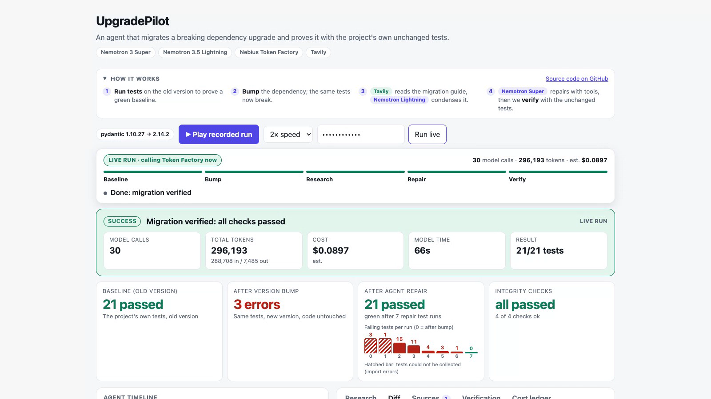
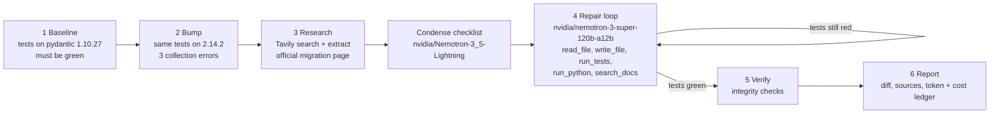

# UpgradePilot

[](https://github.com/Namans12/Nebius/actions/workflows/ci.yml)
[](LICENSE)

**An agent that migrates a breaking dependency upgrade (pydantic v1 to v2) and proves it with the project's own, unchanged tests.**

**[Live demo](https://upgradepilot.onrender.com)** (press *Play recorded run*; live runs need the access code from the Devpost testing instructions) · **[GitHub](https://github.com/Namans12/Nebius)** · **Demo video**<!-- VIDEO_URL -->

Built for the Nebius x NVIDIA Global AI Hackathon, track Coding and Agentic Engineering (also entered for Best Use of Tavily). Runs on **Nebius Token Factory** with **NVIDIA Nemotron** models and uses **Tavily** at runtime.



Dependency bots open a pull request that goes red and stop there, because the breaking changes live in a migration guide the tooling never reads. UpgradePilot reads the guide, edits the code, runs the tests on the real target version, and loops until they pass, then runs integrity checks so a green result is not a faked one.

## Why it matters / what's new

- **Real breaking changes, not renamed methods.** The fixture fails on pydantic 2.14.2 with collection errors and removed APIs (`Field(regex=...)`, `__root__`, `Optional[X]` now required, int to str coercion gone, error `type` strings changed). The baseline is green, the bump is red, and a hand-written solution proves the task is solvable.
- **Research is a pipeline step, not decoration.** Tavily finds and extracts the official guide at runtime; a cheap Nemotron model condenses it for the failures that were actually observed; a stronger one repairs with tools.
- **Evidence, not vibes.** Every run produces a diff, cited sources, a failures-per-step strip, and a measured token ledger (dollar costs are estimates). We benchmarked three Nemotron sizes on the same task and report the failures.
- **Verification is deterministic** and stricter than "tests pass" (see below).

## Pipeline



1. **Baseline**: project tests on pydantic 1.10.27 must pass.
2. **Bump**: the same tests on 2.14.2 fail (3 collection errors block all 21 tests; about 15 still fail after the first fix).
3. **Research**: Tavily search (restricted to `docs.pydantic.dev`) plus extract of the migration page; Lightning condenses it into a checklist for the observed failures.
4. **Repair**: Super edits `app/*.py` with tools until the tests pass, bounded by a 40-turn limit, a per-run spend cap and a time cap.
5. **Verify**: tests run with `--noconftest`; every file outside `app/` is hashed and must be unchanged; writes are only allowed to `app/**/*.py`; installed version must equal the target; the pass count must equal the baseline count; no `pydantic.v1` shim and no deprecated v1 API (regex ban list) left in `app/`.
6. **Report**: diff, cited sources, failures per step, and the ledger.

The demo project (`demo/pydantic_service`) is a small order service written for pydantic v1 with 21 tests. A hand-written solution (`demo/pydantic_service_solution`) is used only to prove the task is solvable; the agent never sees it.

## Where Nebius, NVIDIA and Tavily are used

| Sponsor | What | Where |
|---|---|---|
| **Nebius Token Factory** | OpenAI-compatible endpoint `https://api.tokenfactory.nebius.com/v1` for all model calls; live per-token prices from `GET /v1/models?verbose=true` for the cost ledger; token counts from each response's `usage` | `upgradepilot/agent.py`, `upgradepilot/ledger.py` |
| **NVIDIA Nemotron** | `nvidia/Nemotron-3_5-Lightning` condenses the retrieved docs (one call per run); `nvidia/nemotron-3-super-120b-a12b` runs the tool-calling repair loop | `upgradepilot/agent.py`, `scripts/bench.py` (Lightning/Ultra comparison) |
| **Tavily** | Search (official docs domain) and extract at runtime in every run; the agent can call `search_docs` again mid-repair; hits and sources are shown in the Research and Sources tabs | `upgradepilot/research.py`, `upgradepilot/agent.py`, `web/index.html` |

## Results

Small samples on one task (October 30 2026), same 40-turn limit; reproduce with `scripts/bench.py`, archived in `docs/benchmark.json`.

| Repair model | Passed | Calls | Est. cost per run | Model time |
|---|---|---|---|---|
| Super (`nemotron-3-super-120b-a12b`) | **5 / 5** | 21-34 | $0.043-0.122 (mean $0.079) | 44-80 s |
| Lightning (`Nemotron-3_5-Lightning`) | 0 / 5, all hit the turn limit | 41 | $0.028-0.031 | 96-206 s |
| Ultra (`Nemotron-3-Ultra-550b-a55b`) | 0 / 2, both hit the turn limit | 41 | $0.634-0.709 | 100-107 s |

**Counting every run of the final repair loop, Super passed 16 of 17:** the 5 benchmark runs, 3 development runs, 3 fresh-clone runs (2 passed; 1 failed at the turn limit after 41 calls and $0.23, about 3x a typical run), 1 deployed-site run before we restricted Tavily's search to the official docs domain, 2 runs after that fix, 1 run through the hardened verifier locally, and 2 live runs on the deployed site (29 calls / $0.082 / 78 s and 30 calls / $0.090 / 66 s of model time). **Only the 5 benchmark runs are archived in this repo; the rest come from our own terminal logs.** The failure shows why live runs have a per-run spend cap.

Lightning with Super escalation passed 0 of 2, and one more Ultra run failed ($0.47), so Ultra is 0 of 3 overall; those extra runs are not in the table. Two earlier Super runs on a previous version of the loop are excluded. Five runs is not a rigorous benchmark and covers one task, but the gap is large: it is why Lightning does the cheap reading and Super does the repair, and why Ultra is not in the default path. Input tokens dominate cost (roughly 240-330k prompt tokens versus 8-10k completion tokens per run). Dollar figures are **estimates** from catalog prices; token counts are measured.

## Honest limits & known issues

- **Not a security sandbox.** Model-edited code runs in a subprocess with a scrubbed environment (no API keys passed), a timeout and a prebuilt virtualenv. In the Docker image, subprocesses also drop to an unprivileged uid (`UP_SANDBOX_UID=65534`). This is a mitigation, not a sandbox: it isolates dependencies, not the host, and the Docker path was only exercised on the deployed Render instance. Only the bundled project can be upgraded; there is no arbitrary-repository input.
- **Passing the suite does not prove behaviour is preserved.** Concrete example from the recorded run: the agent's rewritten `app/errors.py` dropped the `value_error.number.not_ge -> too_small` mapping. No test covers it, so the suite stays green and every check passes, but that error code silently changes. We left the recording as it was.
- **Verification today:** tests run with `--noconftest`, every file outside `app/` is hashed, writes are allowed only to `app/**/*.py`, and the pass count must equal the baseline count. The deprecated-API check is a deterministic regex ban list and can be bypassed (it also has false positives such as `dict.copy()`).
- **One migration, Python only.** Dependency versions come from prebuilt environments rather than being resolved at run time.
- **Model output varies run to run.** The diffs are real but not always elegant (one run used `object.__setattr__` to set a computed field on a frozen model); read them.
- **Ultra 0/3 is one task and one untuned harness**, not a general claim about the model.
- **The free Render instance sleeps** after inactivity; the first load can take up to a minute.

## Run it locally

Requirements: Python 3.12, [uv](https://docs.astral.sh/uv/), a Nebius Token Factory key and a Tavily key.

```bash
git clone https://github.com/Namans12/Nebius.git && cd Nebius   # the project lives in the repo root
cp .env.example .env            # add NEBIUS_API_KEY and TAVILY_API_KEY
uv sync
./scripts/build_envs.sh         # builds the pydantic 1.x and 2.x test environments
uv run python -m upgradepilot.cli                       # one live run in the terminal
UP_ACCESS_CODE=choose-a-code uv run uvicorn upgradepilot.server:app --port 8123   # web UI
```

Open the UI and press **Play recorded run** (a real run captured earlier, labelled *Recorded*), or enter the access code and press **Run live**. Live runs are limited to one at a time and a daily cap, and each stops at a per-run spend cap. To re-record: `uv run python scripts/record.py`.

## Tests

```bash
uv sync && ./scripts/build_envs.sh   # build_envs is needed once for the sandbox tests
uv run pytest -q                     # 85 tests, no API keys, no paid calls
```

CI (`.github/workflows/ci.yml`) runs the same three commands on every push and pull request.

## Deploy

`render.yaml` is a Render blueprint (Docker, free plan, health check `/api/config`). The `Dockerfile` bakes both test environments into the image. Set these environment variables:

| Variable | Purpose |
|---|---|
| `NEBIUS_API_KEY`, `TAVILY_API_KEY` | model and search access (required) |
| `UP_ACCESS_CODE` | enables live runs; without it only the recorded run plays |
| `UP_MAX_RUN_SECONDS` | optional wall-clock cap per run (default 300) |
| `UP_MAX_LIVE_RUNS` | optional daily live-run cap (default 15) |
| `UP_SANDBOX_UID` | optional uid for model-run subprocesses when running as root (set to 65534 in the Dockerfile) |

## Layout

```
upgradepilot/   agent.py (pipeline + tools)  research.py (Tavily)  sandbox.py  verify.py  ledger.py
                server.py (FastAPI + SSE)  runner.py  cli.py
web/            index.html: single-page UI (research, diff, sources, verification, cost ledger)
demo/           pydantic_service (v1 project + 21 tests) · pydantic_service_solution (reference only)
recordings/     pydantic_run.json: a real run for replay
scripts/        build_envs.sh · bench.py · record.py · spike.py (throwaway feasibility check)
tests/          85 tests: agent loop, sandbox, ledger, server (no paid calls)
docs/           FEEDBACK.md · SUBMISSION.md · VIDEO_SCRIPT.md · benchmark.json · screenshot.png
.github/        workflows/ci.yml
Dockerfile · render.yaml · pyproject.toml · uv.lock · .env.example · LICENSE
```

License: MIT.
